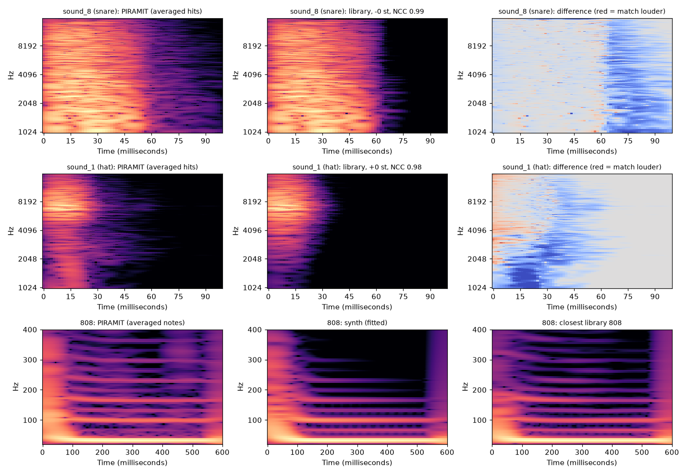

# reference-dissector

Take a reference track apart and rebuild it in Ableton Live. The pipeline:

1. finds the tempo grid, the meter and the tuning;
2. finds every drum hit, layered hits included, and the 808's notes to the cent;
3. transcribes the melodic layers and the chords;
4. identifies the exact samples in your library (or the nearest ones), at any pitch;
5. fits a synthesized 808;
6. builds the result in Live, with the original stems muted underneath for A/B, through [ableton-live-mcp](https://github.com/CanArslanDev/ableton-live-mcp).

**Replica mode** ([12](docs/12-replica-mode.md)) aims at a 1:1 rebuild of a trap or hip-hop reference, measured against the answer on 48 synthetic beats where every answer is known.

The work started from one question: *can an AI that cannot hear tell whether the sound it placed is the sound in the song?* It can, if listening is turned into measurements it can read (numbers and pictures) and those measurements are calibrated against cases with a known answer. This repository holds the code, the measurements and what was learned on the way, from a Turkish trap track (Mavi – *PIRAMIT*) and a set of synthetic beats built for the purpose.



## Results at a glance

**PIRAMIT** (126 s, Demucs stems), from `refdissect analyze`, `melodic`, `match`, `fit-808` and `plan` with replica mode (the run of 2026-10-29, `fit-808` and `plan` run again on the final code of 74931ce; [02](docs/02-case-study-piramit.md) gives the m3 code's plan, the first replica-mode run, of 2026-10-22, and the run before replica mode beside it):

| What | Found |
|---|---|
| Tempo grid | **137.00 BPM** (136.999), 4/4, first bar line 23.4 ms in. beat_this's 144 beats lie on one line at 68.498 BPM, and 100–180 BPM takes the octave above. Every bar's onsets sit within a few ms of the grid (p90 4.7–11.3 ms). At the 136.36 BPM a beat tracker gave, they drift 8 ms a bar: 50 ms off by bar 7, 0.59 s by the end (computed). |
| Tuning | The melodic stems at **A440** (other −2, piano +1.5 cents). The **808 alone sits at +11.8 cents**: its sample is detuned, not the track. That is its template's settled pitch (32.93 Hz); the +33 cents read before replica mode heard the 808's pitch drop. (An earlier version read +0.28 semitones for everything; that was `librosa.estimate_tuning`'s error, see [01](docs/01-pipeline.md#tuning-gridtuning).) |
| Hi-hat | A hat from the local library, at its own pitch. NCC 0.984; it wins 310 of 327 hits; null-test residual −14.9 dB (next best −10.9 dB). The verdict is "same family", not "same sample" as before replica mode: searched at any pitch, another kit's hat 3 semitones up reaches 0.958, and the margin fell from 0.078 to 0.025. The joint fit found 54 of its 389 hits under other sounds, 36 of them under the snares. |
| Snare (odd bars) | A library snare pitched **−1 semitone** (Transpose −1, Detune 0). NCC 0.923; it wins 28 of 28 hits; residual −8.3 dB (next best −7.1 dB). The same file plays at its own pitch in bars 24–31 (NCC 0.986, 30 of 30 hits, residual −15.7 dB), on a pad of its own. Before replica mode this table had odd and even bars swapped. |
| Snare (even bars) | Not in the library: the best match is NCC 0.47. |
| 808 | 101 notes, 87 of them on C1. No note is held over silence now: on 2026-10-22 one B0 note was held 15.3 s through sections D and E, over a 1.2 s and a 7.4 s rest (the 808 band 40 dB under its median note peak) and the notes the 808 plays alone in D. A note now ends where the 808 falls silent, and a 9 dB rise starts one: D has four C1 notes. The stem shows a fifth attack there, which rises only 6.5 dB over the note still ringing and is still kept in it (not checked by ear). A synth voice fitted to the template's 53 notes reaches NCC 0.938 and a 1.3 dB envelope error, against the best of 865 library 808s at 0.894 and 1.4 dB. The library 808 is closer in the upper harmonics: 8.7 dB off, against 12.9 dB for the synth. The fit starts at 120 Hz with a 0.3 ms attack, both on its search's bounds: the shape of a kick's sweep (not checked by ear). The one-shot the plan plays now follows the template's own pitch until its drop settles (269 ms): the C1 notes of 120–250 ms needed a 41-cent Detune correction with the m3 code's one-shot and need −0.1 cents now, and 91 of the 101 notes sound within 20 cents of the analysis as the plan plays them (82 before). Its waveform NCC against the fit's reference fell from 0.921 to 0.880 (not checked by ear). |
| Sections | A 1–24 · B 25–28 · C 29–32 · A 33–47 · D 48–51 · E 52–56 · A 57–71 · D 72–73: D is the 808 alone, E the breakdown, as the stem shows them. On 2026-10-22 the held 808 note merged them into one section, D 49–56. |
| Live | Planned, not built: 630 drum notes on 10 Drum Rack pads, each at its match's Transpose and Detune and at a Volume of its own where the stems hold its sound, −12.1 to 0 dB under a −12.5 dB drum fader (not checked by ear; the loudest, a perc, is read mostly on hits it shares with the hat); 101 808 notes at Transpose +36 and Detune +1; three muted melodic tracks; 8 locators. The 2026-10-22 plan had 607 notes on 7 pads: a pad now needs 5 hits here, not 12, and a sound of the residual pass must recur bar to bar. That adds a perc, the hat's file found in the snare band and a snare-like sound (7–8 notes each, not checked by ear). Before replica mode, `refdissect live-build` built the earlier plan (6 pads, 549 drum notes, 126 808 notes, reference stems for A/B, 8 locators) into an empty Live set with one `build_tracks` call, in 4.9 s on Live 12.4.2 (9.7 s track by track before). |

**Replica mode, on the calibration-v2 suite** (`refdissect suite`; [03](docs/03-calibration.md), [12](docs/12-replica-mode.md)).
- 48 synthetic beats in 22 scenarios: 72–160 BPM, 3/4 and 6/8, swing, rolls, layered hits, flams, pitched copies, 808 glides, melodic layers, lead-ins.
- Each is mastered, passed through mp3 and separated by Demucs.
- Scores are strict: no offset is removed, and a hit counts within 20 ms of where its sound starts.
- Means over scenarios. The analysis is what the pipeline heard; the plan is what Live will play, rendered offline.
- "Now" is replica mode with its fixes of 2026-10-29 (tags m3 and m3-ft); [12](docs/12-replica-mode.md) gives the merged code before them (m2g) beside it.

| | before replica mode | now (htdemucs, the default) | now on htdemucs_ft |
|---|---|---|---|
| drum hits and 808 onsets, F1@20, analysis / plan | 0.368 / 0.282 | 0.888 / 0.876 | 0.900 / 0.902 |
| drums, F1@20, analysis / plan | 0.397 / 0.283 | 0.883 / 0.868 | 0.895 / 0.898 |
| kick / snare / hat, F1@20, analysis | 0.25 / 0.70 / 0.51 | 0.88 / 0.96 / 0.86 | 0.93 / 0.89 / 0.91 |
| open hat, F1@20, analysis / plan | 0.33 / 0 | 0.98 / 0.98 | 0.99 / 0.99 |
| kick timing, median (p90), analysis | +16.6 (20.9) ms | +0.1 (5.3) ms | −0.5 (3.3) ms |
| 808 notes (50 ms, 50 cents), F1, analysis / plan | 0.278 / 0.229 | 0.936 / 0.921 | 0.924 / 0.910 |
| 808 pitch, median abs error, analysis / plan | 55 / 70 cents | 6 / 8 cents | 12 / 14 cents |
| 808 written note right | not scored | 0.970 | 0.959 |
| beats / downbeats, F, analysis | 0.72 / 0.64 | 0.96 / 0.94 | 0.96 / 0.94 |
| melodic notes, F1; chords, majmin (4 beats) | not read | 0.63; 0.98 | 0.64; 0.98 |
| plan levels: median distance from a perfect kit | 7.2 dB | 4.1 dB | 3.7 dB |

- **Drum pads on evidence.** A sound gets a pad from 3 hits (one per 16 bars in a longer song), with a clean template and a close library match or a place in the beat's backbone; a sound of the residual pass must also recur bar to bar. The 12-hit gate this replaced left open hats at 0.043 in the plan. False hits fell from 23.0 to 9.6 a beat (10.2 to 3.7 on htdemucs_ft), against the merged code before these fixes (tags m2g-vel and m2g-ft-vel). Each drum note now starts early by its pad sample's own attack.
- **Plan levels got worse** (m2g-vel → m3): 3.7 → 4.1 dB from a perfect kit, balance 2.2 → 3.0 dB (htdemucs_ft 3.2 → 3.7 dB and 2.0 → 2.8 dB). No pad has a level of its own: each plays its sample at 0 dB and only the drum fader is matched. The open hats the gate now plays sit a median 11.4 dB over a perfect kit (9.1 dB on htdemucs_ft). Open.
- **The 808 is written at the right pitch more often** (m2g-vel → m3: 0.947 → 0.970), but the plan plays bass_low-1's 808 a median 41.7 cents off (17.5 before), so the plan's 808 note F1 went 0.926 → 0.921 and its median error 7.7 → 8.3 cents. Open.
- **htdemucs stays the default.** htdemucs_ft's drums are better, but its 808 notes (bass_low 0.949 → 0.338) and its snares (0.961 → 0.891) are worse.
- **Velocities follow Live 12.4.6's measured law**, with "Vol < Vel" set to 35 % on every Simpler. Built with linear velocities, m2g's plans would have played 9.3 dB from a perfect kit in Live, against 3.7 dB (computed from the law).
- **Not verified in Live:** no replica-mode plan has been built in Live and recorded yet.
- The scores: `results/calibration/suite-base-htdemucs.json`, `suite-m3.json` and `suite-m3-ft.json`; the merged code before the fixes of 2026-10-29, `suite-m2g-vel.json` and `suite-m2g-ft-vel.json`.

**Calibration v1**: 6 synthetic beats built from known library samples, mastered loud, passed through mp3 and Demucs.

| Sound | Identified at known hit times | Blind transcription F1 (mean) | Identified blind |
|---|---|---|---|
| Snare | 6/6 | **1.00** | 6/6 |
| Open hat | 6/6 | 0.83 | 5/5 |
| Hat | 5/6 | 0.77 | 7/10 templates |
| Kick | 4/6 | 0.70 | 5/10 templates |
| 808 | 6/6 (865 candidates, ±12 semitones) | — | — |

At known hit times, 27 of 30 sounds are found among 8,854 one-shots. Details are in [docs/03-calibration.md](docs/03-calibration.md).

## How it works

```
song.mp3 ──Demucs──▶ stems ──▶ grid + tuning ──▶ drum templates ──▶ hits (joint fit)
                       │                               │
                       │                               └──▶ library match, any pitch ──▶ pads
                       ├──▶ 808 notes (transpositions of its own 808) ──▶ 808 fit (synth) ──┐
                       └──▶ melodic notes and chords                                        │
                                                                                            ▼
          plan.json (notes in beats, pads with Transpose and Detune, levels, locators) ──▶ Live (ableton-live-mcp)
```

- **Grid**: beat_this's beats and downbeats decide the octave, the first bar line and the meter. A comb search over tempo and phase on the onset envelope, coarse then fine, gives the tempo, and its phase is moved onto the attacks. `--bpm-range` picks between half and double time.
- **Drums**: in each band (low, snare, hat), onsets are moved back to where their sound starts. They are grouped by their place in the beat (straight or swung 16ths, triplets, 32nds), then by waveform: one template per sound. Averaging N hits lowers whatever plays along by about √N.
  - A second pass groups the onsets no template explains: rare sounds, crashes, fills.
  - Each template slides over the whole stem as a matched filter. Every moment is then fit with all the templates near it (non-negative least squares on the kick, snare and hat bands). So a hat under a snare, a flam's grace note, a 64th roll and a hat at another pitch are hits of their own.
- **Identification**: normalized cross-correlation (NCC) against every library one-shot, in three bands, over ±30 ms of lag.
  - In the snare and hat bands it works at any pitch, to a quarter cent. A speckle index, the fine structure of a noisy sample's spectrum, proposes the file and its transposition. Kicks keep whole semitones.
  - Identities are handed out from the strongest match down, so a hat that always plays along with a kick is not taken for the kick.
  - A library file that peaks under −60 dBFS is never a match, and a band whose five best sounds tie within 0.002 NCC names none of them: a kick's click in the hat band matched 20 kick, 808 and synth-bass files alike.
  - The verdict uses NCC, the margin over the next *different* sound and per-hit votes; a null test is reported beside it. A pad plays its match with Simpler's Transpose and Detune.
- **808**: notes are read as transpositions of the song's own 808: a template learnt from its long notes, preferably those that start on kicks. A note's written pitch is its settled pitch less the 808's tuning.
  - A note ends where the 808 falls 40 dB under its peak, and a rise of 9 dB starts a new one. Where the template's own notes are too short to settle, its settled pitch is read on the notes that reach past it.
  - A sine + glide + envelope + tanh-drive voice is fitted to the template's notes by differential evolution. It is scored on waveform, harmonics and envelope, not on correlation alone.
  - Simpler's Transpose and Detune put the one-shot on the written notes.
- **Melodic layers**: Basic Pitch on each tonal stem, moved onto A440 by its tuning. Chords come from its note posteriorgrams, with the 808 as their bass. The plan carries them as muted MIDI tracks.
- **Live**: [ableton-live-mcp](https://github.com/CanArslanDev/ableton-live-mcp)'s `build_tracks` builds the whole set from one spec.
  - A sound gets a Drum Rack pad on evidence: enough hits, a clean template, and a close match or a place in the beat's backbone; a sound of the residual pass must also recur bar to bar. Each note starts early by its pad sample's attack, and a pad plays each strike once.
  - The drum and 808 faders are matched to the stems' levels; each pad plays its sample at 0 dB. Velocities follow Live's measured law, and the stems are muted for A/B.
  - The replica-mode settings (Detune per pad, the 808's Detune and Glide, "Vol < Vel") are not verified in Live yet.
- **Measuring**: `refdissect suite` builds synthetic beats with every answer kept, runs the pipeline on them and scores the analysis and the plan against the answer.

Each step is described in [docs/01-pipeline.md](docs/01-pipeline.md), replica mode in [docs/12-replica-mode.md](docs/12-replica-mode.md).

## Quick start

Needs Python 3.11+ and [uv](https://docs.astral.sh/uv/). Three models run in uv environments of their own, installed on first use: Demucs for `separate` (a few hundred MB), beat_this for `analyze` (an 81 MB checkpoint) and Basic Pitch for `melodic`. For `live-build`, Ableton Live must be running with [ableton-live-mcp's Remote Script](https://github.com/CanArslanDev/ableton-live-mcp#install).

```bash
git clone https://github.com/CanArslanDev/reference-dissector && cd reference-dissector
uv sync                                   # add --extra live for live-build

W=~/refdissect                            # a work folder outside the clone (docs/09)
# your sample library, once; index-library also writes the speckle index (any-pitch matching)
uv run refdissect inventory "/Applications/Ableton Live 12 Suite.app/Contents/App-Resources/Core Library/Samples" \
    "<your User Library folder>" --out "$W/work/inventory.json"
uv run refdissect index-library "$W/work/inventory.json" --out "$W/work/library.npz"
uv run refdissect index-library "$W/work/inventory.json" --808 --out "$W/work/library_808.npz"
uv run refdissect index-speckle "$W/work/library.npz"    # only for a library indexed before the speckle index

# a song
uv run refdissect separate song.mp3 --out "$W/song/stems"
uv run refdissect analyze "$W/song/stems" --work "$W/song/refdissect"    # grid, drums, 808 notes
uv run refdissect melodic "$W/song/refdissect"                           # notes per tonal stem, chords
uv run refdissect match "$W/song/refdissect" --library "$W/work/library.npz"
uv run refdissect fit-808 "$W/song/refdissect" --library-808 "$W/work/library_808.npz"
uv run refdissect plan "$W/song/refdissect"            # plan.json + midi/drums.mid, midi/808.mid
uv run --extra live refdissect live-build "$W/song/refdissect"   # into an empty Live set

# comparing and choosing (docs/11)
uv run refdissect separate rebuild.wav --out "$W/song/rebuild_stems"      # the same model as the reference
uv run refdissect compare "$W/song/stems" "$W/song/rebuild_stems" --out "$W/song/compare.json"
uv run refdissect listening-round ref.wav cand1.wav cand2.wav --question "Which chords?" --out "$W/song/round1"
uv run refdissect space "$W/song/stems/other.wav" --spans 40-56 100-116
uv run refdissect mix-gains "$W/song/recorded" --targets targets.json

# calibration v1: six synthetic beats from your own library, scored
uv run refdissect calibrate "$W/work/inventory.json" --library "$W/work/library.npz" \
    --library-808 "$W/work/library_808.npz" --beats 6 --out "$W/work/calibration"

# calibration v2 (replica mode): 48 beats with every answer kept, run and scored per tag (docs/03, docs/12)
S="$W/work/calibration-v2"
uv run refdissect suite build "$W/work/inventory.json" --out "$S" --v1-truth "$V1_TRUTH"
uv run refdissect suite run "$S" --library "$W/work/library.npz" --library-808 "$W/work/library_808.npz" \
    --tag mine --jobs 2 --render                           # --model htdemucs_ft, --scenarios a,b, --resume, --cache
uv run refdissect suite run "$S" --library "$W/work/library.npz" --library-808 "$W/work/library_808.npz" \
    --tag mine-b --steps analyze,match,plan,score --reuse mine --jobs 2 --render
uv run refdissect suite report "$S" --tags mine,mine-b --out "$W/work/mine-b.md"
```

Every step writes JSON next to its inputs, so you can read what it decided before the next step uses it.
- `analyze` and `fit-808` keep the 808 reader's result and the 808 fit in the work folder's `cache/`. A later run reads them back where nothing that decides them changed: the stems' or the template's samples, the settings, numpy's, scipy's and soxr's versions, and every `.py` file of the package as the process loaded it. The log names each file read back; `--no-cache` runs them again. `suite run` keeps nothing unless `--cache`, so its seconds are the code's.
- `scripts/export_results.py` turns a work folder into the shareable `results/` and `figures/`: no audio, and no file names from a personal library.
- `scripts/export_results.py --suite DIR TAG` publishes a suite tag's means per scenario, and nothing else.
- `--v1-truth` takes the six v1 beats rebuilt with truth stems. No command here makes them: without them the suite has the 42 scenario beats. [12](docs/12-replica-mode.md) has every suite option.

## Documentation

| | |
|---|---|
| [01 – Pipeline](docs/01-pipeline.md) | Every step, its parameters and why they are what they are |
| [02 – Case study: PIRAMIT](docs/02-case-study-piramit.md) | Everything measured on the track, including what is still wrong |
| [03 – Calibration](docs/03-calibration.md) | Synthetic beats with a known answer: v1's six beats, and the 48-beat calibration-v2 suite with its strict scores |
| [04 – Identifying samples](docs/04-identifying-samples.md) | What "the same sound" means, and how NCC, margin, votes and null tests decide it |
| [05 – Synthesizing the 808](docs/05-808-synthesis.md) | The voice model, the fit, and why one similarity number is not enough |
| [06 – Listening for a model](docs/06-listening-for-a-model.md) | How a model that cannot hear compares sounds: numbers, pictures, calibrated verdicts |
| [07 – Building in Live](docs/07-building-in-live.md) | The plan, the ableton-live-mcp tools used, and Live behaviour measured on the way |
| [08 – Pitfalls](docs/08-pitfalls.md) | Every mistake made here and how it showed up |
| [09 – Data and copyright](docs/09-data-and-copyright.md) | What is published, what stays local, and why |
| [10 – Roadmap](docs/10-roadmap.md) | What replica mode finished, the targets and their gaps, and what comes next |
| [11 – A new beat in a song's style](docs/11-style-beat-lessons.md) | Two rejected beats: the groove, effect and same-pipeline checks they led to, and what each step cost |
| [12 – Replica mode](docs/12-replica-mode.md) | Rebuilding a reference 1:1: running it, the stages and their files, what each measured, and what is not verified in Live |

Türkçe özet: [README.tr.md](README.tr.md)

## Layout

```
src/refdissect/
  audio.py       read, bands, transposition (as Simpler does it), attack times, onset trimming
  xcorr.py       normalized cross-correlation and the matched filter (lag convention tested)
  hits.py        onsets, where sounds start, grouping hits by waveform, averaging into templates
  grid.py        tempo/phase fit, octave, bar line, meter, swing, tempo map, per-beat offsets, tuning
  beats.py       beat_this's beats and downbeats, in its own uv environment
  detect.py      template discovery on the attacks, one template per sound, each hit counted once
  layers.py      every drum moment fit with every template: layers, flams, rolls, pitched copies
  bass808.py     the 808's notes as transpositions of its own template, to the cent
  library.py     inventory, index, speckle index, matching (NCC at any pitch), votes, null test, verdicts
  describe.py    producer-facing descriptors: pitch/cents, glide, decay, harmonics, brightness
  synth808.py    the 808 voice, its fit, one-shots
  melodic.py     notes per tonal stem, loop voting, chords
  basicpitch.py  Basic Pitch in its own uv environment; posteriorgram frames by time
  structure.py   per-bar activity and sections
  groove.py      ducking under the kick, drum-role balance, one-shots cut by their notes
  space.py       width per octave, reverb tails, the band-pass between two sections
  rhythm.py      a layer's rhythm from onsets (48 points per bar)
  loudness.py    BS.1770 integrated loudness
  listening.py   A/B files: reference, beep, candidate at equal loudness
  mixsim.py      gains decided on recorded stems instead of re-recording
  symmetric.py   a rebuild and its reference measured the same way, against the reference's own spread
  rounds.py      listening rounds: numbered reference-beep-candidate files and a manifest
  live.py        plan (pads with Transpose and Detune; the 808 with Detune and Glide), MIDI files, the build
  render.py      a plan played offline, as the plan-level scores assume Live plays it
  separate.py    Demucs in its own uv environment, seeded
  scenarios.py   calibration v2: 21 scenarios rendered with their truth (events.json)
  voices.py      the scenarios' melodic parts, every note known
  suite.py       calibration v2 end to end: build, run per tag (--steps, --reuse), report
  evaluate.py    strict scores of an analysis or a plan against a truth (schema refdissect.events/1)
  calibrate.py   calibration v1: synthetic beats and their scoring
  figures.py     spectrograms side by side, the calibration plot
  pipeline.py    the steps, each writing JSON
  cache.py       the 808 reader's results and the 808 fits kept on disk, keyed on their inputs and the code
  cli.py         refdissect
  workers/       the Demucs, beat_this and Basic Pitch workers
results/         measured numbers (calibration v1, the suite's means per scenario, PIRAMIT) - no audio
figures/         spectrograms and the calibration plot
scripts/         export_results.py
tests/           synthetic drums, 808 lines and short scenario beats: lag convention, grouping, layers, the
                 808 reader, matching, grid, scoring, plan, suite, caches
```

## Status

This is a working pipeline with measured limits, not a finished product:
- **Measured on synthetic beats.** On the calibration-v2 suite, drum hits and 808 onsets score F1@20 0.888 in the analysis and 0.876 in the plan. A song has no truth to score against.
- **The plan's levels are a regression.** No pad has a level of its own, so the plan sits 4.1 dB from a perfect kit, against 3.7 dB before the pad gate.
- **The plan's 808 on short, low notes.** bass_low-1's fitted one-shot falls faster than the 808 it copies, and the plan plays it a median 41.7 cents off (17.5 cents before its notes were written at the right pitch).
- **The build in Live is not verified for replica mode.** Detune per pad, the 808's Detune and Glide, and the build as a whole have not been recorded in Live. The plan's velocities follow the law measured in Live 12.4.6, which no build has checked yet.
- **Melodies are transcribed but not played.** They go to muted placeholder tracks, and the original melodic stems play under the rebuilt beat.
- **The 808's slides are off by default.** The reader writes no legato notes. The rule this replaced, which called every unattacked pitch move a slide, was right 6 times in 79; the opt-in rule (`slides=True`) made 18 legato notes, 6 of them right, on the beats its thresholds were chosen on.

See the [roadmap](docs/10-roadmap.md).

## License

MIT for the code (see [LICENSE](LICENSE)). The songs, their stems and any samples are not part of this repository and keep their own rights: see [docs/09-data-and-copyright.md](docs/09-data-and-copyright.md).
