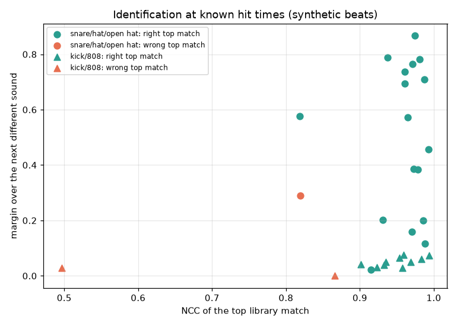

# 03 – Calibration: beats with a known answer

A similarity score means nothing until you know what it does when the answer is known. `refdissect calibrate` builds that answer key from your own library and scores the pipeline against it.

There are two sets:
- **v1**: six beats of one recipe, scored after removing a constant offset per sound. It comes first below.
- **Calibration v2**: a suite of 48 beats in 22 scenarios, with every answer kept and strict scores. It is what replica mode is measured on ([Calibration v2](#calibration-v2-the-suite)).

## The beats

`calibrate.build_beat(seed)` picks, at random from the library inventory:
- a kick;
- a snare or clap;
- a closed hat;
- an open hat;
- an 808 (0.8–4 s);
- a long melodic loop and an acapella, as bleed.

It plays them as a trap beat at 136 BPM for 16 bars:

| sound | pattern (two bars of sixteenths) |
|---|---|
| kick | 0, 7, 10, 16, 23, 26, 30 |
| 808 | with each kick, notes 0, 0, +3, 0, +1, −2, +7 semitones, each cut at the next |
| snare | 8, 24 (beat 3: half time) |
| hats | every eighth except the open hat's, with 16th rolls; velocity 0.55–1.0 |
| open hat | 14 |

**Mastering, like the references.** Mix to −12 dBFS RMS, then +5 dB into a tanh soft clipper. That lands at about −8.6 dB RMS, within the −7 to −10 LUFS range measured on the reference tracks. It then goes through mp3 at 256 kb/s (ffmpeg) and Demucs `htdemucs`.

**Every beat is hard in the same ways:**
- the snare always lands on a hat;
- the 808 starts with every kick;
- the loop and the vocal bleed into every stem.

The six beats used here drew 30 sounds from 8,854 one-shots, plus 865 808s.

## Identification at known hit times (`oracle`)

**Method.** The true hit times are what a perfect drum transcription would give.
1. The hits at those times are averaged.
2. The average is matched against the whole library.
3. The test: is the true sample (or a copy of it under another name) the top match?

**27 of 30.**

| sound | found | NCC of the true sample | margin of the top match over the next different sound |
|---|---|---|---|
| snare / clap | 6/6 | 0.96–0.99 | 0.12–0.78 |
| open hat | 6/6 | 0.93–0.97 | 0.16–0.87 |
| hat | 5/6 | 0.53–0.99 | 0.02–0.71 |
| kick | 4/6 | 0.41–0.99 | 0.00–0.07 |
| 808 (±12 semitones) | 6/6 | 0.90–0.97 | 0.03–0.08 |



**What the plot shows:**
- **Noisy sounds** (snare, clap, hats) are unique as waveforms. The right match stands 0.1–0.9 above everything else.
- **Tonal sounds** (kick, 808) are mostly decaying sines. Any two at the same pitch correlate 0.9+, so even the right match leads by less than 0.08. For them, the waveform tells the *family* reliably and the *exact file* only weakly. Pitch glide, decay and harmonics have to decide ([05](05-808-synthesis.md)).

**The three misses:**
- **A kick that never matched (0.41).** Its file has a long quiet lead-in; Demucs split it oddly.
- **A hat that lost to the snare.** Hats on the eighth grid include beat 3, where the snare always sounds, so the averaged "hat" carried the snare.
- **A kick whose true file came second** by 0.026.

## The whole pipeline, blind (`blind`)

Nothing known:
1. fit the grid (found 135.99–136.02 BPM on all six);
2. discover templates;
3. detect hits;
4. match.

Each template is assigned to the true sound most of its hits belong to (precision ≥ 0.5). Its hits are scored after removing a constant offset: the truth is where the sample file starts, a detection is where the attack is. A sample with 20 ms of quiet lead-in is found 20 ms late every time.

| sound | transcription F1 per beat | mean | identified |
|---|---|---|---|
| snare | 1.00, 1.00, 1.00, 1.00, 1.00, 1.00 | **1.00** | 6/6 templates (NCC 0.955–0.984) |
| open hat | 1.00, 0.00, 1.00, 1.00, 1.00, 1.00 | 0.83 | 5/5 |
| hat | 0.52, 0.94, 0.71, 0.68, 0.94, 0.84 | 0.77 | 7/10 |
| kick | 0.97, 0.00, 0.87, 0.93, 0.67, 0.75 | 0.70 | 5/10 |

Hats and kicks are the weak part, for the reason above: they always play together with something else. Beat 2 is the beat with the odd kick and the snare-covered hat.

## How the numbers moved while building the pipeline

Each fix below was found by these scores, which is the point of having them:

| change | effect |
|---|---|
| hits grouped naively in the full band (first attempt) | 11/24 drum sounds identified blind |
| detection on the attack (40–80 ms) instead of 300 ms | snare detections had landed 352 ms early, locked to the following kick; now F1 1.00 |
| duplicates need the same waveform in *both* bands | snares had been dropped as "the hat" (F1 0 in 5 of 6 beats) |
| scoring after removing a constant offset | a 21 ms lead-in had scored a perfect snare as F1 0 |
| matching over ±30 ms of lag | blind snare identification 0/6 → 6/6 |
| low band (< 200 Hz) for kicks, with tail suppression | synthetic kick F1 0.67 → 1.00 |

## Running it

```bash
uv run refdissect calibrate "$W/work/inventory.json" --library "$W/work/library.npz" \
    --library-808 "$W/work/library_808.npz" --beats 6 --out "$W/work/calibration"
```

Beats already built and separated are reused. `results/calibration/summary.json` is this run, made with `scripts/export_results.py`.

**Limits:**
- Six beats and one genre: thresholds from 30 sounds are a starting point, not a law.
- The beats have no per-track processing (EQ, reverb, saturation on the snare), which real mixes do. Expect real NCCs a little lower for the same sample: PIRAMIT's −1 snare matches at 0.923 (0.953 before replica mode), though its hat and its snare at its own pitch reach 0.984 and 0.986 ([02](02-case-study-piramit.md)).

## Calibration v2: the suite

v1 has one recipe, and it removes a constant offset per sound before scoring. That rule scored the snares of the v1 plans F1 1.00 while 11 of 12 plans put them 21–24 ms early (htdemucs and htdemucs_ft stems): strict F1 at 20 ms 0. Calibration v2 keeps every answer and scores where each sound attacks, with no offset removed. `refdissect suite` builds it, runs the pipeline on it and scores it ([12](12-replica-mode.md) has the commands and options).

### The beats

`refdissect suite build` (`scenarios.py`) renders 21 scenarios at seeds 1 and 2, and converts the six v1 beats rebuilt from their truth stems (`v1orig-1` to `v1orig-6`): 48 beats.
- A seed draws its kit as v1 does, so scenario `v1` is v1's beat. Every other scenario changes one thing against it, with the same sounds. `full` combines several; `producer` plays producer MIDI.
- Each beat is mastered as v1 is (−12 dBFS RMS, +5 dB into a tanh clipper) and encoded to mp3 at 256 kb/s. The decoded mp3, lined back up (`mix_mp3.wav`), is what the pipeline gets.
- Demucs separates each beat once per model, with seed 0 and one shift: the same stems every time on one device.
- A beat's folder holds its truth (`events.json`), the mix files, `stems_truth/` (every sound on its own track, and the four groups Demucs separates), `stems-<model>/` and `runs/<tag>/`.

| scenario | what changes against v1 |
|---|---|
| `v1` | Nothing: 136 BPM, 16 bars, the pattern above, a melodic loop and a vocal as bleed. |
| `tempo72`, `tempo95` | 72 and 95 BPM, 8 bars. Neither 95 BPM nor its double lies in the 100–180 BPM grid search range. |
| `tempo160` | 160 BPM. |
| `meter34`, `meter68` | 3/4 and 6/8. |
| `swing58`, `swing66` | The second 16th of each 8th at 58 % and 66 % of it (66 %: nearly triplets). |
| `rolls` | Two hat rolls per two bars (32nds, 16th and 32nd triplets, 64ths); 40 % of them climb or fall 1–5 semitones. Open hats are cut by the next closed hat. |
| `layers` | A clap on every snare, 0–8 ms behind it at −6 to 0 dB. A second kick under half the kicks, 3–8 dB down. |
| `kick808` | 30 % of the 808 notes lose their kick and 30 % of the kicks lose their 808. The 808s that keep their kick start 0–20 ms after it. |
| `bass_low` | An 808 line on roots of 20.6–29.1 Hz (E0 to A#0), in 16th notes and same-pitch retriggers, tuned +11 or −20 cents. |
| `glides` | A quarter of the 808 notes glide in from 1–12 semitones away over 50–300 ms, a sixth slide out at their end, and a sixth slide in from the note before without an attack (legato). |
| `drum_pitch` | Kick +2 semitones (seed 1) or −2 (seed 2), snare −0.70 (−1 and +30 cents), hat +0.25, open hat −2. |
| `leadin` | 5–30 ms of noise at −60 dB before each drum sound's attack, as untrimmed files have. |
| `rare` | Perc, tom, crash and rim, 1–12 hits each, where they usually play. |
| `flams` | Every backbeat hit is a flam: the same sound 10–30 ms before it, at −6 dB. |
| `dynamics` | Accents on the beat, the other hats at 0.3–0.9, three ghost snares per two bars at −18 to −12 dB. |
| `melodic` | Pad, pluck arpeggio and lead over chords that change inside the bar (maj, min, 7, maj7, min7, sus2, sus4, dim, add9, slash chords). The 808 plays the chord roots. No loop. |
| `producer` | Single-role producer MIDI patterns from your library (`--midi-dir`): pitched hat copies, chokes, and an 808 that slides where its notes overlap. Without such patterns the scenario is left out. |
| `full` | 54 % swing, a hat roll per two bars, chokes, the clap layer, 808 pickups into the kicks, pad and lead, and the first bar line 0.4 s in. |
| `v1orig` | The six v1 beats, rebuilt from their truth stems (6 beats). |

### The answer

`events.json` (schema `refdissect.events/1`, kind `truth`) holds:
- the grid: tempo, meter, beats, downbeats, swing;
- every drum hit, with its gain, its velocity and what it is layered on;
- every 808 note, with the pitch it sounds at and the pitch it settles to (cents included), its cut and its glide;
- the melodic notes and the chords;
- each sound's file, hash, transposition and attack.

A hit's time is where its file starts. Its attack (`t_attack`) adds `audio.attack_time` of the file as played (lead-in, transposition and cut included), read in the band of its role. That is the one definition of when a sound happens, for the truth and for every estimate.

### Scoring

`evaluate.score` compares an estimate in the same schema with the truth. There are two estimates per beat:
- **Analysis level** (`estimate_from_analysis`): what the pipeline heard, from `analysis.json`, `matches.json` and `melodic.json`.
- **Plan level** (`estimate_from_plan`): what Live would play, from `plan.json` as `render.py` plays it. Each pad plays its sample at its Transpose, Detune and Volume (at most 0 dB), on one voice, and the 808 its one-shot per note, released as Live releases it, each velocity at its level under Live 12.4.6's law. Live itself is not in the loop: two live checks recorded built plans and compared them with this render ([07](07-building-in-live.md#live-behaviour-measured-here)).

The rules:
- **Strict.** No offset is removed. Both sides time a hit at its attack, and a hit counts within 20 ms (50 ms is reported too). Pairs come from a maximum one-to-one matching (mir_eval).
- **Drum sounds.** Each estimated sound plays the truth sound it scores the best F1 at 50 ms on. One whose distinct moments match that sound less than half the time is extra: it is counted, and scored nowhere.
  - A truth sound's F1 pools the hits of every estimated sound that plays it, so a hit played twice is a false hit.
  - A pitched copy or a layer is a sound of its own.
  - Per role, the mean over the truth's sounds of that role.
- **Headline.** "Drum hits and 808 onsets, F1@20" is the mean over the truth's drum sounds and the 808's onsets.
- **808.** Notes count within 50 ms (or 20 ms) and 50 cents, with offsets ignored.
  - The pitch error of the notes matched within 50 ms, in cents.
  - The settled pitch, and the written note: the MIDI note an estimate writes, against the truth's settled pitch less its tuning.
  - Legato notes: precision and recall.
- **Melodic notes**: F1 at 50 ms and 50 cents, with offsets ignored. **Chords**: mir_eval's duration-weighted accuracy (root, majmin, sevenths, tetrads, mirex).
- **Rhythm**: beat and downbeat F at 70 ms (mir_eval), the first bar line's error modulo a bar, the meter, the tempo octave and the swing ratio.
- **Levels** (plan level, with `--render`): per truth sound, the energy in its role's band over 50 ms from each side's attack, rebuild over truth stem, median over its hits.
  - The plan's faders match the separated stems' RMS. A perfect kit would therefore play every drum at the drums' `kit_db`: the separated stem's RMS minus the truth's drum group's. On the htdemucs baseline that is −5.5 dB (mean over scenarios), because Demucs separates the clipped mix while the truth is before the clipper.
  - The headline is the median, over sounds, of each sound's distance from that kit level.
- **Pads** (plan level): the share of truth drum sounds that a pad plays with their own file (the same sha256), and how far off its pitch such a pad plays (Transpose + Detune/100 against the truth's semitones + cents/100).
- **Means.** Over a scenario's beats, then over the 22 scenarios, so each scenario counts once.

v1's rule, one constant offset removed per sound, is reported beside the strict scores for continuity.

### Results

Means over the 22 scenarios, all 48 beats, rendered:
- `base-htdemucs`: before replica mode (471fd70);
- `m1`: with the beat_this grid and the melodic step (e1bd9ce);
- `m2g`: with the four lanes merged and five merge fixes (9ccc759). htdemucs stays the default model;
- `m2g-ft`: the same code on htdemucs_ft stems;
- `m3`: with the fixes of 2026-10-29 (6d96bc5): the pad gate, the kick view, the 808's silences and settled pitch, the speed changes and the pad-files round ([12](12-replica-mode.md#what-each-stage-measured)). match, fit-808, plan and score ran at 6d96bc5 over the analyze and melodic of `m3a`, a run of every step at e2a5ab4, whose code for those two steps is the same;
- `m3-ft`: the same on htdemucs_ft stems;
- `m4`: m3 with the last two fixes of 2026-10-29 merged (e7ea748): a level per drum pad (levels/pads) and the 808 one-shot on its template's periods (glide/808). fit-808, plan and score ran at e7ea748 over m3's analyze, melodic and match;
- `m4-ft`: the same on htdemucs_ft stems;
- `m5`: m4 with the fixes of the first live check merged (live/build, a4f2358): each pad on one voice and the 808's release and restart in the render and the estimates, a note Live starts late placed 1 ms early, and the plan's meter. plan and score ran at a4f2358 over m4's other outputs;
- `m5-ft`: the same on htdemucs_ft stems.

Each of these tags ran every step except m3, m3-ft, m4, m4-ft, m5 and m5-ft, as above. m2 and m2-ft measured the first merge (ba7b69d), before m2g's five fixes. m2g-vel and m2g-ft-vel, the baseline of the fixes of 2026-10-29, are m2g's and m2g-ft's plans under Live's velocity law; they differ from m2g and m2g-ft only in the level scores (below). Each tag's means per scenario are in `results/calibration/suite-<tag>.json`.

**Per drum role, strict F1@20, analysis / plan** (in brackets: the scenarios that have the role):

| role | base-htdemucs | m1 | m2g | m2g-ft | m3 | m3-ft |
|---|---|---|---|---|---|---|
| kick (22) | 0.247 / 0.182 | 0.305 / 0.201 | 0.872 / 0.845 | 0.927 / 0.919 | 0.882 / 0.871 | 0.935 / 0.925 |
| snare (22) | 0.695 / 0.493 | 0.801 / 0.600 | 0.961 / 0.813 | 0.891 / 0.816 | 0.961 / 0.935 | 0.891 / 0.919 |
| clap (4) | 0.458 / 0.208 | 0.458 / 0.208 | 0.500 / 0.500 | 0.625 / 0.625 | 0.500 / 0.500 | 0.625 / 0.625 |
| hat, pitched copies included (22) | 0.508 / 0.549 | 0.504 / 0.569 | 0.859 / 0.845 | 0.913 / 0.916 | 0.860 / 0.861 | 0.913 / 0.919 |
| open hat (22) | 0.326 / 0 | 0.303 / 0 | 0.979 / 0.043 | 0.993 / 0.022 | 0.980 / 0.981 | 0.993 / 0.993 |
| tom (`rare`) | 0 / 0 | 0 / 0 | 0.500 / 0 | 0.450 / 0 | 0.500 / 0.500 | 0.450 / 0.450 |
| crash (`rare`) | 0 / 0 | 0 / 0 | 0.500 / 0 | 0.500 / 0 | 0.500 / 0.500 | 0.500 / 0.500 |
| rim (`rare`) | 0 / 0 | 0 / 0 | 0.500 / 0 | 0 / 0 | 0.500 / 0.500 | 0 / 0 |
| perc (`rare`) | 0 / 0 | 0 / 0 | 0 / 0 | 0 / 0 | 0 / 0 | 0 / 0 |
| all drum sounds | 0.397 / 0.283 | 0.431 / 0.319 | 0.880 / 0.612 | 0.893 / 0.648 | 0.883 / 0.868 | 0.895 / 0.898 |

**Timing, signed median error (p90 of its size), ms, analysis / plan:**

| | base-htdemucs | m1 | m2g | m2g-ft | m3 | m3-ft |
|---|---|---|---|---|---|---|
| kick | +16.6 (20.9) / +9.6 (12.7) | +17.7 (22.0) / +9.8 (12.6) | 0.0 (6.1) / +2.1 (7.9) | −0.5 (3.4) / +1.9 (3.4) | +0.1 (5.3) / −0.3 (5.6) | −0.5 (3.3) / −0.6 (2.2) |
| snare | −6.4 (8.3) / −14.6 (15.9) | −6.0 (7.7) / −13.5 (14.7) | +0.8 (3.2) / +1.1 (3.0) | +0.3 (3.8) / −0.1 (2.9) | +0.8 (3.2) / +0.5 (3.2) | +0.3 (3.8) / −0.4 (3.3) |
| hat | +1.1 (3.4) / −1.3 (7.7) | −0.5 (2.9) / −3.9 (7.2) | −0.4 (3.3) / +0.6 (4.2) | −0.3 (1.7) / +1.9 (2.5) | −0.4 (3.3) / −1.2 (2.9) | −0.3 (1.7) / −0.3 (1.4) |
| 808 onsets | −4.1 (37.1) / −2.2 (32.9) | −4.1 (37.1) / −2.2 (32.9) | +1.4 (8.0) / +1.4 (8.0) | +1.4 (7.0) / +1.4 (7.0) | +1.4 (8.0) / +1.4 (8.0) | +1.4 (7.0) / +1.4 (7.0) |

**Per area, analysis / plan** ("–": that tag's scorer had no such score, or the step did not run):

| | base-htdemucs | m1 | m2g | m2g-ft | m3 | m3-ft |
|---|---|---|---|---|---|---|
| drum hits and 808 onsets, F1@20 | 0.368 / 0.282 | 0.396 / 0.311 | 0.886 / 0.667 | 0.898 / 0.700 | 0.888 / 0.876 | 0.900 / 0.902 |
| drums, F1@50 | 0.472 / 0.328 | 0.517 / 0.359 | 0.892 / 0.627 | 0.895 / 0.650 | 0.894 / 0.879 | 0.897 / 0.900 |
| sounds that play no truth sound, per beat | 0.16 / 0.05 | 0.16 / 0.05 | 1.96 / 0.71 | 1.95 / 0.32 | 1.96 / 0.05 | 1.98 / 0.02 |
| 808 onsets, F1@20 | 0.270 / 0.303 | 0.270 / 0.303 | 0.935 / 0.935 | 0.944 / 0.944 | 0.935 / 0.935 | 0.944 / 0.944 |
| 808 notes, F1 (50 ms, 50 cents) | 0.278 / 0.229 | 0.278 / 0.229 | 0.936 / 0.926 | 0.924 / 0.910 | 0.936 / 0.921 | 0.924 / 0.910 |
| 808 notes, F1 (20 ms, 50 cents) | 0.160 / 0.159 | 0.160 / 0.158 | 0.911 / 0.901 | 0.913 / 0.896 | 0.911 / 0.896 | 0.913 / 0.896 |
| 808 pitch, median abs error (cents) | 55.3 / 69.8 | 55.3 / 69.8 | 6.0 / 7.7 | 12.1 / 13.9 | 6.0 / 8.3 | 12.1 / 13.6 |
| 808 settled pitch within 50 cents | – | – | 0.940 / 0.925 | 0.964 / 0.958 | 0.962 / 0.925 | 0.964 / 0.935 |
| 808 written note right | – | – | 0.947 / 0.947 | 0.937 / 0.937 | 0.970 / 0.970 | 0.959 / 0.959 |
| 808 legato notes written (the truth: 24 on 5 beats) | – | – | 0 | 0 | 0 | 0 |
| beats, F (70 ms) | 0.715 / 0.920 | 0.962 / 0.962 | 0.962 / 0.962 | 0.962 / 0.962 | 0.962 / 0.962 | 0.962 / 0.962 |
| downbeats, F | 0.637 / 0.823 | 0.939 / 0.892 | 0.939 / 0.892 | 0.939 / 0.892 | 0.939 / 0.892 | 0.939 / 0.892 |
| first bar line, abs error (ms) | 81.0 / 18.2 | 40.7 / 18.2 | 40.7 / 18.2 | 40.1 / 18.2 | 40.7 / 18.2 | 40.1 / 18.2 |
| meter right | 0.91 / 0.91 | 0.95 / 0.91 | 0.95 / 0.91 | 0.95 / 0.91 | 0.95 / 0.91 | 0.95 / 0.91 |
| tempo in the right octave | 0.89 | 0.91 | 0.91 | 0.91 | 0.91 | 0.91 |
| swing ratio, estimate minus truth | – | −0.040 | −0.040 | −0.040 | −0.040 | −0.040 |
| melodic notes, F1 (4 beats; the plan's are the same notes) | – | 0.630 | 0.630 | 0.635 | 0.630 | 0.635 |
| chords, majmin / sevenths (analysis) | – | 0.888 / 0.862 | 0.977 / 0.929 | 0.979 / 0.912 | 0.977 / 0.929 | 0.979 / 0.912 |
| levels: median abs distance from a perfect kit (plan) | 7.18 dB | 7.19 dB | 3.67 dB | 3.21 dB | 4.09 dB | 3.70 dB |
| levels: median abs balance (plan) | 4.15 dB | 3.82 dB | 2.25 dB | 1.98 dB | 3.03 dB | 2.84 dB |
| truth sounds a pad plays with their own file (plan) | – | – | 0.574 | 0.641 | 0.839 | 0.898 |
| largest pitch error of such a pad (plan) | – | – | 0 cents | 0 cents | 0 cents | 0 cents |
| seconds per beat after separation (jobs) | 190 (3) | 90 (2) | 142 (2) | 141 (2) | 113 (2) | 128 (4) |

base-htdemucs_ft, the before of the m2g-ft column: drums 0.470 / 0.354; kick 0.581 / 0.637, snare 0.556 / 0.319, hat 0.626 / 0.589, open hat 0.324 / 0.006; 808 notes 0.173 / 0.146; levels 3.81 dB.

m3's and m3-ft's seconds are m3a's and m3a-ft's, which ran every step at e2a5ab4, the same code but for the pad-files round (match only); m3 reused their analyze and melodic. m3a-ft ran at 4 jobs, so its seconds do not compare with m2g-ft's ([Time and memory](#time-and-memory)).

**m3 → m4.** m4 and m4-ft equal m3 and m3-ft on every number in the three tables above but the seconds (below) and these (plan level):

| | m3 | m4 | m3-ft | m4-ft |
|---|---|---|---|---|
| drum hits and 808 onsets, F1@20 | 0.8757 | 0.8756 | 0.9021 | 0.9021 |
| 808 onsets, F1@20 | 0.935 | 0.934 | 0.944 | 0.944 |
| 808 notes, F1 (50 ms, 50 cents) | 0.921 | 0.934 | 0.910 | 0.934 |
| 808 notes, F1 (20 ms, 50 cents) | 0.896 | 0.909 | 0.896 | 0.920 |
| 808 pitch, median abs error | 8.3 cents | 4.5 cents | 13.6 cents | 9.6 cents |
| 808 settled pitch within 50 cents | 0.925 | 0.970 | 0.935 | 0.958 |
| levels: median abs distance from a perfect kit | 4.09 dB | 1.25 dB | 3.70 dB | 1.23 dB |
| levels: median abs balance | 3.03 dB | 0.55 dB | 2.84 dB | 0.50 dB |
| the 808 against the kit | −1.98 dB | −1.87 dB | −2.24 dB | −2.01 dB |

The exports give m4's note F1@20 as 0.9095 and m4-ft's note F1@50 as 0.9345: their means over scenarios, from the beats' counts, are 0.9094 and 0.9344. m4 ran only fit-808, plan and score, at 4 jobs: 57.4 s a beat over scenarios (fit-808 56.2 s), 695 s wall for the 48 beats (m4-ft 698 s), not comparable with the seconds above.

**m4 → m5.** m5 and m5-ft equal m4 and m4-ft on every number above but the seconds and these (plan level):

| | m4 | m5 | m4-ft | m5-ft |
|---|---|---|---|---|
| downbeats, F | 0.892 | 0.924 | 0.892 | 0.924 |
| meter right | 0.91 | 0.95 | 0.91 | 0.95 |
| 808 pitch, median abs error | 4.47 cents | 4.42 cents | 9.65 cents | 9.63 cents |
| 808 onsets, median error | 1.360 ms | 1.355 ms | 1.435 ms | 1.433 ms |
| levels: median abs distance from a perfect kit | 1.247 dB | 1.198 dB | 1.231 dB | 1.152 dB |
| levels: median abs balance | 0.552 dB | 0.512 dB | 0.497 dB | 0.476 dB |

meter34 is planned in 3/4 now (meter right 0 → 1, downbeat F 0.29 → 1.0 there). The levels are worse in single scenarios: dynamics 1.27 → 2.16 dB from a perfect kit, where one voice per pad plays dynamics-2's drum track 1.3 dB quieter at unity and its RMS-matched fader rose by as much; balance in 11 scenarios (htdemucs_ft 6), by up to 0.23 dB (0.08). No scenario of either model is further off on either than at m3. Each drum role's timing median and p90 moved 0.01 ms at most. m5 ran plan and score only, at 4 jobs: 5.8 s a beat over scenarios (m5-ft 4.4 s), 74 s wall for the 48 beats (53 s). [12](12-replica-mode.md#what-each-stage-measured) has each fix alone.

**Levels under Live's velocity law.** m2g and m2g-ft rendered velocities as linear levels (v/127). m2g-vel and m2g-ft-vel ran plan and score again on their other outputs, with velocities from Live 12.4.6's law at "Vol < Vel" 35 % (`suite-m2g-vel.json`, `suite-m2g-ft-vel.json`). Distance from a perfect kit 3.67 and 3.21 dB, balance 2.24 and 1.98 dB, the 808 −1.97 and −2.24 dB against the kit; every other number is unchanged. With v/127 velocities, Live would have played m2g's plans 9.30 dB from a perfect kit and m2g-ft's 9.59 dB (computed from the law: pads at 45 %, the 808 at 35 %). In Live the law held from velocity 35 to 127, on pads and on the 808 (the first live check, [07](07-building-in-live.md#live-behaviour-measured-here)).

**Levels with the pad gate.** m3's plans sit 4.09 dB from a perfect kit, against 3.67 dB at m2g-vel (htdemucs_ft 3.70 against 3.21), and their balance is 3.03 against 2.24 dB (2.84 against 1.98). On the sounds both tags measure, the per-beat median moved only 3.55 → 3.58 dB (3.09 → 2.97 dB). Most of the rise comes from sounds measured for the first time, which the gate now plays: 44 open hats at a median 11.4 dB over a perfect kit (47 at 9.1 dB on htdemucs_ft), 6 snares at +3.5 dB, a crash, a rim and a tom at +3 to +5 dB. At m3 no pad had a level of its own: a pad played its sample at 0 dB, and only the drum fader was matched, by RMS over all the pads. The 808 sat −1.98 and −2.24 dB against the kit, as at m2g-vel.

**Levels per pad** (m4). Each pad plays where the stems hold its sound, a kick on drums + bass less the plan's own 808, the loudest pad at 0 dB ([01](01-pipeline.md#plan)). m3 → m4: 4.09 → 1.25 dB from a perfect kit (htdemucs_ft 3.70 → 1.23), balance 3.03 → 0.55 dB (2.84 → 0.50); no scenario of either model is further off on either than at m3. Against m2g-vel, no scenario's distance is worse, and balance only in rolls, 0.745 → 0.88 dB (htdemucs_ft full, 0.815 → 1.33). Per role against the kit, m3 → m4: hats +6.23 → −1.10 dB, open hats +11.57 → −0.09, snares +3.28 → −0.17, kicks −1.57 → −0.96 (htdemucs_ft +6.47 → −0.69, +10.54 → −0.83, +2.21 → −0.80, −0.57 → −0.08). The 808 sits −1.87 and −2.01 dB against the kit. Pad Volumes run −19.7 to 0 dB (−20.7 to 0). In Live a pad's Volume is held a display step under the text sent, and a hit plays what is held within 0.003 dB (the first live check).
- **Worse per beat.** Against a perfect kit, the kick against the snare is further off than at m3 on 2 of 42 beats (6 of 43): bass_low-2, whose kick's hits play the hat's file (the analysis gave its kick sound the hat's file, and its hats, found 29 ms early, a kick file that is neither sound's; bass_low's kick 12.1 → 15.4 dB under the kit, its snare 1.3 → 2.5 dB), and tempo95-2, whose kick plays where it did at m3 and its snare 2.2 dB louder: its kick reads 1.7 dB lower under the new one-shot than under m3's, and the RMS-matched drum fader made that up, which lifted the other pads. On htdemucs_ft, dynamics' snare sits 3.8 dB under the kit (1.0 at m3-ft) and tempo72's 2.9 dB (0.4).
- **Balance across two groups.** Balance is each sound against the median sound, the 808 included, and the htdemucs drum stem sits 5.52 dB under the truth's drums where its bass stem sits 0.96 dB under the truth's bass. With the drums at their kit level the 808's balance reads +2.70 dB (−1.76 at m3; htdemucs_ft −0.05 and −3.96).
- **The level against the truth stem** (`level_db`) is worse by that kit offset: the drums now sit at their kit level, 5.52 dB (2.51) under the truth's drums. Over the suite it is worse by up to 5.8 dB (hats; toms 4.3, crashes 4.1, snares 3.4, rims 2.5 dB), and by up to 7.8 dB in one scenario (rolls' hats); open hats are not worse. On htdemucs_ft only snares (3.0 dB) and toms (1.0 dB) are worse. `vs_kit_db` is the number within the kit.

**What changed what:**
- **The grid** moved in m1 (beat_this) and not since.
- **The 808's numbers** are the 808 lane's. The 808 reader does not read the drum templates, so m2 and m2g are identical there. At m3 the settled pitch is read on the notes where the template's own drop never settled, and notes end at a silence and start on their rise ([01](01-pipeline.md#808-notes-bass808transcribe)).
- **Chords** rose from m1 to m2g (majmin 0.888 → 0.977) because melodic now reads the new 808 notes as the chords' bass. m3 changes no chord or melodic number.
- **The drum numbers** come from the discovery and joint-fit lanes and the merge's fixes ([12](12-replica-mode.md) gives each lane alone). From m2g to m3, the kick view changes the analysis' drums, and the pad gate and the notes' early start the plan's.
- **m4** changes only the plan's 808 and its levels. Every analysis number, and every drum note, pad (but its Volume) and melodic track of the plan, equals m3's on all 48 beats of both models. Every 808 number equals the glide/808 branch's own tag (g8-f1), and its one-shots are the same, byte for byte.

**Still weak** (m4; m5 moved only the plan's levels and meter):
- **layers** (drums F1@20 0.614, plan 0.562): its clap always plays with the snare and gets no template of its own.
- **full** (0.656): its hats (0.617), copied at several pitches with few hits each. Its plan 808 notes fell 0.890 → 0.851 at m4 (htdemucs_ft 0.910 → 0.890): the analysis writes one note a semitone high and hears 5 short notes 41 cents low, which m3's one-shot happened to offset.
- **rare** (0.672): sounds of 1–12 hits each. Perc scores 0; tom, crash and rim 0.5 each, in the plan too since the pad gate.
- **bass_low**: its hats (F1@20 0.006). Its 808 is written at the right pitch since m3 (0.987 of the notes, 0.487 at m2g), and the plan plays it so since m4: plan note F1@50 on bass_low 0.904 → 0.788 → 0.974, m2g-vel → m3 → m4 ([01](01-pipeline.md#plan)). Its kick sits 15.4 dB under the kit in the plan (above).
- **The plan's levels per beat** (above): the kick against the snare on bass_low-2 and tempo95-2.
- **Timing outliers.** Means over scenarios stay under 10 ms, but single scenarios do not.
  - Kick p90 at analysis level: 17.1 ms on melodic (27.1 at m2g), 11.8 ms on drum_pitch, 11.4 ms on tempo95.
  - Snare: 24.0 ms on flams, 21.1 ms on producer.
  - Hat: 32.0 ms on bass_low, 11.1 ms on melodic, 10.4 ms on tempo160.

**htdemucs or htdemucs_ft.** On m4 against m4-ft, and on m5 against m5-ft with the same numbers, htdemucs_ft's drums are better:
- 0.883 → 0.895 at analysis, 0.868 → 0.898 in the plan (at m2g the plan's gain was +0.039 [+0.017, +0.062], a paired 95 % bootstrap over the 48 beats);
- kick 0.882 → 0.935, hat 0.860 → 0.913.

But its 808 notes are worse at analysis level (0.936 → 0.924; in the plan both are 0.934 since m4's one-shot, against 0.921 and 0.910 at m3), and so are its snares (0.961 → 0.891).
- bass_low's 808 falls 0.949 → 0.338. bass_low-2 scores 0.03 there: its template is read from its tail, 57 cents flat, and `settle()` refuses its readings.
- producer's falls 0.821 → 0.667.

The first merge (m2 against m2-ft) and m2g give the same picture. htdemucs stays the default.

**The 808 reader**, on the 808 lane's 10 scenarios (bass_low, glides, kick808, v1, v1orig, full, producer, melodic, tempo72, tempo160; 24 beats), m1 → m2g. Every scenario has an 808; these are the ones its lane was measured on. The merge left the 808's numbers as its lane left them.
- note F1@50: 0.289 → 0.918 at analysis, 0.230 → 0.902 in the plan;
- note F1@20: 0.181 → 0.903 and 0.167 → 0.887;
- onset F1@20: 0.282 → 0.937;
- median abs cents: 49.4 → 7.6 and 74.9 → 8.4;
- settled pitch 9.5 cents off (median), within 50 cents for 0.897 of the notes;
- the written note right for 0.912 of the notes. bass_low is at 0.487: bass_low-1's template settles 59.7 cents sharp, from a drop fitted on 110–220 ms notes, and each note is written a semitone high.

Since 2026-10-29 the settled pitch of such a template is read on the notes that reach past it (`settle()`, [01](01-pipeline.md#808-notes-bass808transcribe)). Over all 48 beats, m2g-vel → m3 (htdemucs_ft in brackets): the written note right 0.947 → 0.970 (0.937 → 0.959), bass_low 0.487 → 0.987 (0.065 → 0.559); the settled pitch's median error 6.8 → 5.0 cents (5.8 → 5.1); note F1@50 the same, 0.936 (0.924). In the plan, note F1@50 0.926 → 0.921 and the median pitch error 7.7 → 8.3 cents, on htdemucs_ft the settled pitch within 50 cents 0.958 → 0.935: all of it bass_low-1, whose fitted one-shot the plan played further off ([01](01-pipeline.md#plan)). At m4 the one-shot follows its template's periods ([01](01-pipeline.md#fit-808)): m3 → m4, plan note F1@50 0.921 → 0.934 (0.910 → 0.934), median pitch error 8.3 → 4.5 cents (13.6 → 9.6), settled within 50 cents 0.925 → 0.970 (0.935 → 0.958); bass_low 0.788 → 0.974 (0.229 → 0.513), full 0.890 → 0.851 (0.910 → 0.890).

Legato notes are off by default: none are written, against the truth's 24 on 5 beats. The earlier rule wrote 79, and 6 of them were right.

**Drum pitch** (plan level): drum_pitch's snare (−0.70 semitones) and hat (+0.25) now play 0 cents off. With whole semitones they were 30 and 25 cents off.

### The fixes of 2026-10-29

Seven changes were made on branches of their own, each measured there, then merged and run on all 48 beats of both models. The first five: m3a and m3a-ft at e2a5ab4, every step run, then m3 and m3-ft at 6d96bc5 over m3a's analyze and melodic. The last two, the pad levels and the 808 one-shot: m4 and m4-ft at e7ea748, fit-808, plan and score over m3's other outputs. Against m2g-vel (m2g-ft-vel), no drum role of any scenario fell by more than 0.005, at analysis or plan level. [12](12-replica-mode.md#what-each-stage-measured) gives each one alone; in short:
- **The pad gate** (plan): pads on evidence, the backbone first, each strike once, and each note early by its sample's attack. Plan drums F1@20 0.612 → 0.868 (0.648 → 0.898), open hats 0.043 → 0.981 (0.022 → 0.993), false hits 23.0 → 9.6 a beat (10.2 → 3.7). Plan levels worse (above).
- **The kick view** (analysis): each view right after its main, merges and hand-offs by measure. Analysis drums 0.880 → 0.883 (0.893 → 0.895), kick 0.872 → 0.882 (0.927 → 0.935), kick p90 6.13 → 5.28 ms.
- **The 808** (analysis): notes end at a silence and start on their rise; the settled pitch read on the notes. Written note right 0.947 → 0.970 (0.937 → 0.959).
- **Speed**: the same outputs, faster (below).
- **Pad files** (match): a silent file is never a match, and a tied band names no sound. Plan levels 4.21 → 4.09 dB (3.79 → 3.70) against m3a; no pad plays a file under −60 dBFS (1 of 227 → 0; 1 of 229 → 0).
- **Pad levels** (plan; levels/pads, tag lv-f3 at its own code over outputs equal to m3's): each pad at a Volume of its own, read where the stems hold its sound. Plan levels 4.09 → 1.27 dB from a perfect kit (3.70 → 1.31), balance 3.03 → 0.56 dB (2.84 → 0.54).
- **The 808 one-shot** (fit-808 and plan; glide/808, tag g8-f1, against m3a, whose 808 is m3's): the fitted voice on its template's periods, laid out as the template is. Plan 808 note F1@50 0.921 → 0.934 (0.910 → 0.934), median pitch error 8.3 → 4.5 cents (13.6 → 9.6).
- **Merged** (m4): every 808 number is g8-f1's. The levels moved to 1.25 dB (1.23) and 0.55 dB (0.50): a kick is read under the plan's own 808, which the new one-shot changes ([01](01-pipeline.md#plan)).
- **After the first live check** (m5, a4f2358): each pad on one voice and the 808's release and restart in the render and the estimates, notes that Live starts late placed 1 ms early, and the plan's meter. Plan levels 1.247 → 1.198 dB from a perfect kit (1.231 → 1.152), balance 0.552 → 0.512 dB (0.497 → 0.476), the plan's meter right 0.909 → 0.955; every F1 the same.

At m3 these were still worse than m2g-vel: the plan's levels; the plan's 808 on bass_low-1; the plan's snare p90, 3.04 → 3.45 ms (2.91 → 3.60) over the 20 scenarios m2g-vel times a plan snare in (producer-1's snare, now played by a pad, carries the analysis' 41.8 ms p90; 3.18 and 3.31 ms over m3's 22); the analysis' hat p90, 3.329 → 3.337 ms (melodic-1 finds more hats); htdemucs_ft's extra sounds at analysis level, 1.955 → 1.977 a beat (tempo160-2's snare-band template now counts as one). False hits rose on single beats: v1-2 6 → 9 and drum_pitch-2 4 → 5 (producer-2 4 → 9 and rare-1 2 → 3 on htdemucs_ft). m4 resolves the first two: plan levels 1.25 dB from a perfect kit against m2g-vel's 3.67 (balance 0.55 against 2.24 dB), bass_low-1's plan note F1@50 1.0 against 0.949. Worse at m4 than at m3:
- plan strict F1@20 0.8757 → 0.8756 and 808 onset F1@20 0.9348 → 0.9344 (htdemucs_ft unchanged): one of swing58-1's 808 notes, 19.981 ms after the truth's at m3, sits 20.001 ms after it at m4, outside 20 ms;
- full's plan 808 notes, and producer's median pitch error, 6.8 → 8.2 cents (15.2 → 21.1), with its note F1@50 up, 0.770 → 0.804 (0.698 → 0.770);
- the kick against the snare on 2 of 42 beats, and the 808's balance (above).

**Recurrence and the tempo** (pad gate, in memory on m2g-vel's analyses, plan level). The suite has no drifting tempo and no tempo change, and its tempo estimates are within 0.022 %. Three stress tests: every time (hits and truth) warped by a tempo rising 3 % over each beat; the analysis bpm 0.2 % and 0.5 % off; two beats joined at two tempi (v1-1 + tempo160-1, v1-2 + tempo95-2, producer-1 + v1-1). With recurrence asked of every template, plan drums F1@20 fell to 0.506 (htdemucs_ft 0.568) on the ramp and 0.637 (0.662) at 0.2 % off, and every sound of the second tempo lost its pad. Asked of residual templates only, on the grid's bars: 0.855 (0.882) on the ramp, 0.867 (0.897) with the ramp kept as the tempo map, 0.853 (0.883) at 0.2 % and 0.849 at 0.5 %; the second tempo's sounds 0.729, 0.982 and 0.975.

**The speed changes keep every output.** At fix/speed's own code (tag fx-speed-2, every step run, no cache), all 48 beats were identical to m2g-vel's, and the 8 htdemucs_ft beats it ran (glides, kick808, layers, drum_pitch) to m2g-ft-vel's: every JSON file with its file names, the templates bit for bit, the MIDI files and the 808 one-shot byte for byte. At the merged code (m3a), `matches.json` and every template are identical to m2g's on all 48 beats of both models. The pad-files round then changes `matches.json` on purpose, on 19 beats of each model (m3a → m3): lists no longer name the silent file, the top match changes on 14 (12) templates (10 where the silent file was first, and the 4 (2) tied bands), and 3 pads change their file; the templates and fit-808's outputs stay the same. `bass808.json`, `synth808.json` and the one-shot differ only where the 808 changes act: the 3 beats whose template `settle()` moved on htdemucs (bass_low-1, dynamics-1, swing66-1), and bass_low-1 and bass_low-2 on htdemucs_ft. `analysis.json` differs on 24 htdemucs beats (17 htdemucs_ft): on 14 (11) only in the joint fit's records (composite and echo; also null_drop on tempo160-2, and pitched on htdemucs_ft's kick808-2); hits differ on 7 (4), the kick view's; 808 notes on 3 (2).

### Time and memory

m3a: the merged code (e2a5ab4), 48 beats, 2 jobs, every step run, no cache, `--render`, on an Apple M4 with Live open (1-minute load 3.2–6.1, mean 4.4). m2g ran the same way on a quiet machine. Means over scenarios:

| | m2g | m3a |
|---|---|---|
| a beat after separation | 141.9 s | 112.6 s |
| analyze | 38.7 s | 34.4 s |
| match | 49.1 s | 28.0 s |
| fit-808 | 50.9 s | 46.2 s |
| melodic | 2.7 s | 3.3 s |
| plan, render and scores together | 0.5 s | 0.8 s |
| the 48 beats, wall | 3,378 s | 2,704 s |

- Over the 48 beats a beat went 140.3 → 112.0 s (−20 %): analyze −11 %, match −43 %, fit-808 −9 %, melodic +23 % (not investigated). Every scenario was faster, by 18–42 s a beat. The two runs shared the machine differently, so this is not a controlled timing.
- m3a used 5,234 s of CPU. A job peaked at 1.73 GB, the process tree at 2.9 GB (sampled every 10 s; m2g 1.7 and 3.3 GB). In m1, fit-808 was 56 of 90 s a beat.
- m3a-ft (htdemucs_ft) ran at 4 jobs: 1,555 s, 128.3 s a beat over scenarios (126.4 s over the 48 beats), the process tree at 4.0 GB. It does not compare with m2g-ft's 2 jobs.
- m4 and m4-ft ran fit-808, plan and score only, at 4 jobs, no cache: 57.4 s a beat over scenarios (fit-808 56.2 s, plan 0.3 s, render 0.5 s), 695 and 698 s wall for the 48 beats.
- m5 and m5-ft ran plan and score only, at 4 jobs, no cache: 5.8 and 4.4 s a beat over scenarios (plan 0.5 s, render 4.0 and 2.6 s), 74 and 53 s wall for the 48 beats.
- **With `--cache`**, on 6 beats (v1, glides and bass_low, both seeds): the run that filled each beat's `cache/` took as long as a fresh one (analyze 35.5 s and fit-808 43.9 s a beat, against 35.6 and 44.7 s). A second run read both back: analyze 8.1 s, fit-808 1.0 s. Every output equals the fresh run's (`analysis.json`, `bass808.json`, `synth808.json`, the templates, the one-shot), the read-back markers and the fit's seconds aside, and the log names each file read back.

### Running it

```bash
uv run refdissect suite build "$W/work/inventory.json" --out "$W/work/calibration-v2" --v1-truth "$V1_TRUTH"
uv run refdissect suite run "$W/work/calibration-v2" --library "$W/work/library.npz" \
    --library-808 "$W/work/library_808.npz" --tag mine --jobs 2 --render
uv run refdissect suite report "$W/work/calibration-v2" --tags base-htdemucs,mine
```

`$V1_TRUTH` holds the v1 beats rebuilt with truth stems (`beatN` folders). No command in this repository makes them; without them the suite has the 42 scenario beats. `--steps`, `--reuse`, `--resume`, `--model`, `--scenarios` and `--cache` are in [12](12-replica-mode.md). A measurement runs without `--cache`, so every step runs and its seconds are the code's. `scripts/export_results.py --suite` publishes a tag's means per scenario, and nothing else: the beats are made from your library and stay local ([09](09-data-and-copyright.md)).

**Limits:**
- The beats are synthetic, mastered alike, without per-track processing.
- Most scenarios have two seeds, so one beat moves a scenario's mean by half its change.
- Thresholds tuned on these beats are measured on the same beats: the suite has no held-out part yet.
